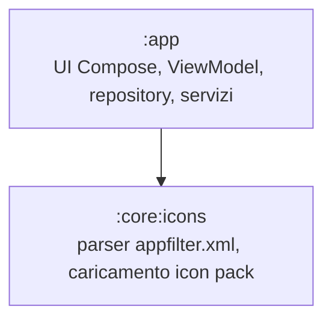
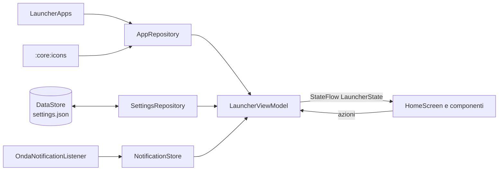

# Architettura di Onda

## Moduli

| Modulo | Contenuto | Dipendenze Android |
|---|---|---|
| `:app` | Activity, UI, stato, accesso al sistema | sì |
| `:core:icons` | `AppFilter`/`AppFilterParser` (puro, testabile su JVM), `IconPacks` (caricamento risorse) | solo `IconPacks` |

## Flusso dei dati

- **`LauncherViewModel`** combina app installate, impostazioni e notifiche in un unico `LauncherState` immutabile (`home`, `allApps`, `favorites`, `suggestions`, …).
- **`SettingsRepository`** espone uno `StateFlow<Settings>` sincrono per la UI; le scritture su disco passano da DataStore in background con un piccolo debounce.
- **`SettingsCodec`** converte JSON ⇄ `Settings` e gestisce le migrazioni di schema (`schemaVersion`). È puro Kotlin e coperto da test.

## Package `ui`

| Package | Contenuto |
|---|---|
| `theme` | `OndaTheme` (Material You, schema statico, tipografia), `Motion`, `OndaTokens` (spaziature, forme) |
| `components` | Righe app/preferiti, icone, scroller alfabetico, card orologio e media, widget ospitati |
| `home` | Schermata principale, gesti verticali, cartelle |
| `drawer` | Elenco di tutte le app per sezioni |
| `search` | Ricerca app/contatti/web, calcolatrice, suggerimenti |
| `settings` | Schermata impostazioni |
| `sheets` | Fogli modali: opzioni app, pannello rapido dell'app |

## Persistenza e migrazioni

1. Avvio: DataStore legge `files/datastore/settings.json`.
2. Se esiste la vecchia chiave SharedPreferences `settings_json` (Onda 0.2/0.3), `LegacyPrefsMigration` la converte e poi la elimina.
3. `SettingsCodec.migrate` porta qualunque JSON (anche i backup) allo schema corrente:
   - schema 1 → 2: `muted` → `mutedNotifications`, `widgets` → `widgetIds`, cartelle da array a mappa.
4. Campi sconosciuti ignorati, campi mancanti con default: i backup restano compatibili in avanti e all'indietro.

## Prestazioni
- Scroller alfabetico disegnato in una sola `Canvas`; lo stato del dito è letto solo in fase di disegno.
- Elenco app sempre composto e mostrato in dissolvenza nello stesso piano della home.
- Build release con R8 e `profileinstaller`.

## Componenti chiave (da CLAUDE.md)
- `:app` — UI in `ui/{theme,components,home,drawer,search,settings,sheets}`, stato in `LauncherViewModel`,
  dati in `data/` (DataStore + `SettingsCodec`), servizi in `service/`.
- `:core:icons` — parser `appfilter.xml`, `IconPacks`/`IconPackCache`, `IconRenderer` (forme, fallback, puntini), `IconMatcher`.
- Gesti righe app: componente `SwipeActions` (destra = popup dell'app `AppQuickPopup`, sinistra = elimina notifiche).
- Home a blocchi ordinabili (`HomeBlocks`: orologio, media, widget, pile, agenda, riepilogo notifiche, app) modificabili con pressione lunga (`HomeEditSheet`) o trascinando (`HomeReorderSheet`).
- Impostazioni: `ui/settings/SettingsScreen` (pagine `SettingsPage`), scelte visive e anteprime in `ui/settings/SettingsVisuals` (`ChoiceTile`, `TileGrid`, `PhonePreview`).
- Popup dell'app in `ui/sheets/AppQuickPopup`; `AppPanelSheet` resta per rispondere sopra la tastiera, `AppActionsSheet` per "Altre opzioni".
- Elenco app (`ui/drawer/AllAppsPanel`): lettere, poi Spazio privato, cartelle e voci di Onda ("Installate di recente",
  "Impostazioni"); il segno `END_OF_LIST_MARK` dell'alfabeto porta lì (`endOfListIndex`).
- Alfabeto (`ui/components/AlphabetWaveScroller`, geometria in `util/AlphabetLayout`): zona di tocco a tutta altezza,
  colonna visibile alta quanto le lettere (max 19dp ciascuna) che riposa in basso e, toccando più in alto, sale sotto il dito
  (`AlphabetLayout.anchoredTop`); in cima `FAVORITES_MARK` riporta ai preferiti.
  `onLetter(lettera)`: la home porta la prima app della sezione al centro dello schermo.
- Vibrazione: sempre `LocalOndaHaptics.current?.perform(HapticEvent.X)` (mai `LocalHapticFeedback` diretto).
  `util/HapticPlan` sceglie primitive o costanti di sistema (testato), `util/OndaHaptics` le suona e segue il sistema.
- Player: visibile solo con riproduzione attiva o pausa recente (`data/MediaRules`).
- Cartelle: `Folder.icon` (vedi `data/FolderIcons`) e `Folder.widgetHeightDp`; più widget = carosello `WidgetStackCard`.
- Ricerca: nessun pannello opaco, solo una velatura (`SEARCH_TINT` in `ui/search/SearchPanel`).
- "Aggiungi alla home" dalle altre app: `PinRequestActivity`; le scorciatoie stanno in `favorites` con `SHORTCUT_PREFIX` (`data/PinnedShortcuts`).
- Meteo: `data/WeatherRepository` legge il provider di Breezy Weather, `data/WeatherData` lo interpreta (solo versione maggiore 0).
- Alfabeto localizzato: `util/IcuSectionIndex` (ICU, non testabile su JVM), ripiego `PlainSectionIndex`; le sezioni sono `String`.
- Popup dell'app personalizzabile: `data/AppPopups`, `ui/sheets/AppPopupEditSheet`. Suggerimenti in home: `data/HomeSuggestions`.
- Backup: `data/BackupArchive` (ZIP, accetta solo `icons` e `fonts`), `data/Backups` (file e WorkManager), `data/AutoBackup` (cartella scelta).
- Promemoria di Usage Breaker: regole in `data/UsageReminders`, controllo in `service/UsageReminderEngine`, avviato dal servizio notifiche.

## Proporzioni (regole del layout, controllate da `UiRulesTest`)
- **Spazi**: su griglia da 8dp; 4dp solo per i dettagli fini.
- **Testi**: scala tipografica di Material 3. Nelle impostazioni: titoli `bodyLarge`, descrizioni `bodyMedium`,
  intestazioni di sezione `titleSmall`.
- **Tocco**: area minima 48dp. Margini laterali uguali a sinistra e a destra.
- **Altezze**: niente altezze fisse su contenitori con testo, si usa `heightIn(min = …)`; i contenitori crescono con il carattere.
- **Componenti comuni, sempre**:
  - pagine e voci delle impostazioni: `SettingsSection`, `SettingsItem`, `SettingsSwitch`, `SettingsSupporting`, `SettingsLabel` in `ui/settings/SettingsKit`;
  - scelte: `TextChoices`, che fa chip in un FlowRow (fino a 3 e corte) o un elenco con radio (`RadioItem`);
  - chip e pulsanti a pillola: `OndaChip`;
  - editor a schermo intero: `TopAppBar` e contenuto con `imePadding`, dentro inset `safeDrawing`.
- **Mai "…"** nelle impostazioni, nei chip e nei pulsanti. Il troncamento è ammesso solo dove è voluto (righe delle app,
  titoli dei brani) e va segnato con il commento `troncamento voluto`; un'altezza fissa voluta con `altezza fissa voluta`.
- **Niente test di screenshot in CI** (decisione del proprietario): gli errori si evitano con i componenti comuni e il controllo statico.
- **Ogni PR che tocca il layout** dice cosa controllare sul telefono, anche con testo grande e in italiano.

## Material 3
Raggi solo dalla scala (4, 8, 12, 16, 20, 28, 32, 48, pieno), testi dai ruoli di `MaterialTheme.typography` (mai `fontSize` a mano, tranne orologio e alfabeto),
bersagli di tocco di almeno 48dp, durate dai token. Regole e differenze volute in `docs/material-audit.md`.
Popup dell'app: movimento Material 3 Expressive (molla spaziale 0,8/380, effetti 1600, uscita 200 ms, contenuto a cascata).

## Benessere digitale
Statistiche pure in `data/UsageStatsMath` (testate), lettura degli eventi in `data/UsageStatsRepository` (launcher e UI di sistema esclusi),
notifiche contate da `NotificationCounter` (solo numeri). Limiti in `Settings.appLimits` (pacchetto -> minuti): pausa nel launcher (`guarded` in HomeScreen)
e avviso da `UsageReminderEngine`. Pagina `SettingsPage.WELLBEING`, grafici in `ui/settings/WellbeingDashboard`.

## Luci di casa e pausa ovunque
Luci: `data/HomeLights` (Wi-Fi, buio, alba/tramonto NOAA, testati), `data/HomePresence` (SSID e ultima posizione, permesso di posizione),
widget scelto con `WidgetTarget.HomeLights`, mostrato accanto all'orologio in HomeScreen. Pausa fuori dal launcher: `data/BreakerGate` +
`OndaAccessibilityService` (solo pacchetto in primo piano) -> `MainActivity.EXTRA_PAUSE_PACKAGE` -> `vm.pauseRequests`.

## Preferiti contestuali
Motore puro in `data/ContextProfiles` (regole E/O, priorità, scelta a mano di un'ora, slot fissi, suggerimenti; testato),
lettura del contesto in `data/ContextReader` (+ `BluetoothWatcher`, `LaunchLog`), profilo attivo in `LauncherViewModel.refreshContext`
(ogni 30 s dalla home) che riordina `home` con `ContextProfiles.favorites`. Pagina `SettingsPage.CONTEXTS` in `ui/settings/ContextProfilesPage`.
