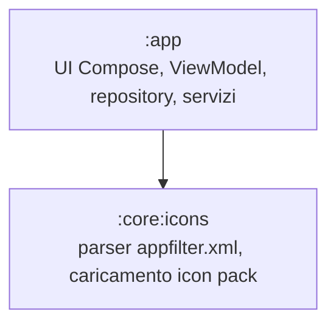
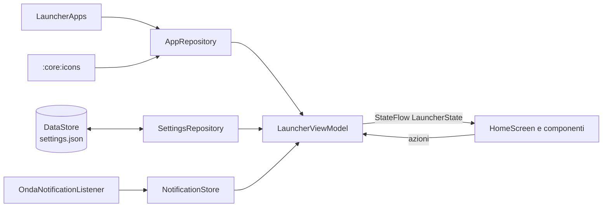

# Architettura di Onda

## Moduli

| Modulo | Contenuto | Dipendenze Android |
|---|---|---|
| `:app` | Activity, UI, stato, accesso al sistema | sì |
| `:core:icons` | `AppFilter`/`AppFilterParser` (puro, testabile su JVM), `IconPacks` (caricamento risorse) | solo `IconPacks` |

## Flusso dei dati

- **`LauncherViewModel`** combina app installate, impostazioni e notifiche in un unico `LauncherState` immutabile (`home`, `allApps`, `favorites`, `suggestions`, …).
- **`SettingsRepository`** espone uno `StateFlow<Settings>` sincrono per la UI; le scritture su disco passano da DataStore in background con un piccolo debounce.
- **`SettingsCodec`** converte JSON ⇄ `Settings` e gestisce le migrazioni di schema (`schemaVersion`). È puro Kotlin e coperto da test.

## Package `ui`

| Package | Contenuto |
|---|---|
| `theme` | `OndaTheme` (Material You, schema statico, tipografia), `Motion`, `OndaTokens` (spaziature, forme) |
| `components` | Righe app/preferiti, icone, scroller alfabetico, card orologio e media, widget ospitati |
| `home` | Schermata principale, gesti verticali, cartelle |
| `drawer` | Elenco di tutte le app per sezioni |
| `search` | Ricerca app/contatti/web, calcolatrice, suggerimenti |
| `settings` | Schermata impostazioni |
| `sheets` | Fogli modali: opzioni app, pannello rapido dell'app |

## Persistenza e migrazioni

1. Avvio: DataStore legge `files/datastore/settings.json`.
2. Se esiste la vecchia chiave SharedPreferences `settings_json` (Onda 0.2/0.3), `LegacyPrefsMigration` la converte e poi la elimina.
3. `SettingsCodec.migrate` porta qualunque JSON (anche i backup) allo schema corrente:
   - schema 1 → 2: `muted` → `mutedNotifications`, `widgets` → `widgetIds`, cartelle da array a mappa.
4. Campi sconosciuti ignorati, campi mancanti con default: i backup restano compatibili in avanti e all'indietro.

## Prestazioni
- Scroller alfabetico disegnato in una sola `Canvas`; lo stato del dito è letto solo in fase di disegno.
- Elenco app sempre composto e mostrato in dissolvenza nello stesso piano della home.
- Build release con R8 e `profileinstaller`.
